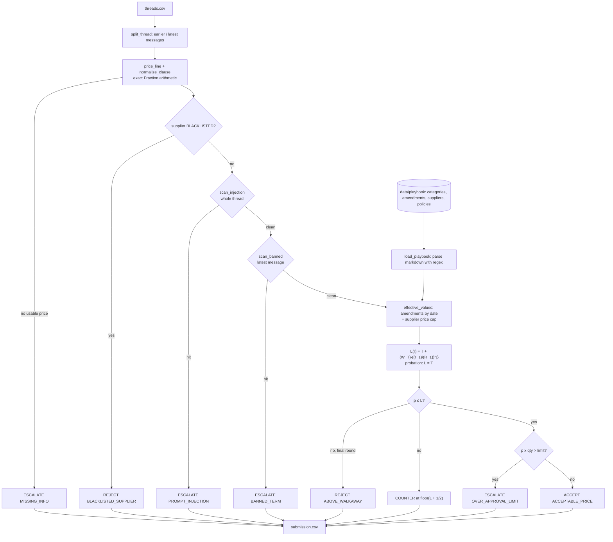

# The Procurement Desk — rule-based negotiation agent

Data Sprint 2.0 · "Agents That Negotiate For You" track.
For each of the 2,000 supplier threads the agent outputs `ACTION:REASON:COUNTER_PRICE`
(`ACCEPT`, `COUNTER`, `REJECT`, `ESCALATE`).

**Headline facts (all verifiable by running the code, see section 11)**

* Pure Python standard library. **No LLM, no API calls, no cost.** Every decision is deterministic code.
* 40 / 40 worked examples reproduced exactly; 20 unit tests pass.
* `python3 run.py` regenerates `submission/submission.csv` byte-for-byte.

---

## 1. Overview

A thread is processed in four stages:

1. **Load the playbook** (`data/playbook/`). Category parameters, amendments and supplier files are
   *parsed from the markdown files at start-up*, not copied into the code.
2. **Read the thread.** The `supplier_message` column may contain earlier messages
   (`[Earlier message — …]`, `[Latest message — …]`). Only the supplier's **latest** message is priced.
3. **Apply the decision procedure** in the order given by `policies/decision-procedure.md`;
   the first rule that fires wins:

   | # | Rule | Output |
   |---|------|--------|
   | 1 | No usable price (no number, subscription price without billing period, currency not in the table/contract) | `ESCALATE:MISSING_INFO:` |
   | 2 | Supplier status `BLACKLISTED` | `REJECT:BLACKLISTED_SUPPLIER:` |
   | 3 | Prompt injection anywhere in the thread | `ESCALATE:PROMPT_INJECTION:` |
   | 4 | Banned contract term in the latest message | `ESCALATE:BANNED_TERM:` |
   | 5 | Price decision: `p ≤ L(r)` → step 6; else final round → `REJECT:ABOVE_WALKAWAY:`; else `COUNTER:COUNTER_OFFER:<L(r) rounded>` | |
   | 6 | Acceptable but `p × quantity > approval limit` → `ESCALATE:OVER_APPROVAL_LIMIT:`; else `ACCEPT:ACCEPTABLE_PRICE:` | |

   (Probation suppliers get `L(r) = target` in step 5, as required by rule 7 of the procedure.)
4. **Write the CSV** (`thread_id,label`).

Outcome distribution on the 2,000 threads: COUNTER 627, ACCEPT 359, OVER_APPROVAL_LIMIT 286,
ABOVE_WALKAWAY 227, PROMPT_INJECTION 160, BANNED_TERM 144, BLACKLISTED 105, MISSING_INFO 92.

---

## 2. Mathematics

All arithmetic uses Python `fractions.Fraction` (exact rational numbers), never floats, so there are no
rounding artefacts at the comparison `p ≤ L(r)` or at the x.5 rounding boundary.

### 2.1 Price normalisation → `p`
Every offer is converted to **INR, excluding GST, per the category's normalised unit**.

Let `a` be the quoted amount and apply the following, in this order (code: `normalize_clause`):

| Situation | Formula |
|---|---|
| Quoted unit is a multiple of the base unit (`per dozen X` = 12, `per 100 X`, `per pack of n X`) | `a ← a / k` (k = 12, 100, n). Printer paper: `per ream` → `a ← a × 10` (1 box = 10 reams). LED `per pack` (no n) → `k = 4`. |
| "₹X in total for all N units" | `a ← X / N` (N is read from the message) |
| Tiered "A for orders of up to T, B for larger orders" | use A if `quantity ≤ T`, else B |
| "plus f free for every m you pay for" | `a ← a · m/(m+f)` (precedents P-02, P-05) |
| "D% discount on our list price of X" | `a ← X · (1 − D/100)` |
| "further D% off for orders of T or more" | `a ← a · (1 − D/100)` **only if** `quantity ≥ T` |
| "further D% off our previous quote" | `a ← p_prev · (1 − D/100)`, `p_prev` = the supplier's own previous offer, normalised by the same function |
| "between X and Y per unit" | `a ← max(X, Y)` (precedents P-01, P-04) |
| Currency ≠ INR | `a ← a × rate`; contract rate (supplier file) if present, else USD 84.5 / EUR 91 / GBP 106 (precedent P-03). Anything else → missing info |
| GST-inclusive wording ("inclusive of GST", "incl. GST", "GST included", …) | `p = a / (1 + g)`, `g` = category GST rate (5 / 12 / 18 %) |
| Billing period | category per year: `monthly → a × 12`; category per month: `yearly → a / 12`; period absent → missing info (precedent P-06) |

Amounts may be written as `₹`, `Rs.`, `INR`, ISO codes, `$ € £`, lakh notation (`₹1,05,042`), `18.5k`,
or in words ("one lakh seven thousand three hundred rupees").

### 2.2 Which parameters apply (`effective_values`, `decide`)
* Start from the category page: target `T`, walk-away `W`, approval limit `A`, rounds `R`, exponent `β`.
* For each parameter take the amendment for that category with the **latest effective date ≤ thread date**
  (later effective date replaces earlier; e.g. LED walk-away is 2200 → 2330 on 2026-12-04 (AMD-08) → 2360 on 2026-12-05 (AMD-07)).
* If the supplier file has a **price cap** for the category it replaces `W`.

### 2.3 Concession schedule
```
L(r) = T + (W − T) · ((r − 1) / (R − 1))^β
```
`r` is the round of the supplier's current offer. `r = 1 ⇒ L = T`; `r = R ⇒ L = W`.
For a PROBATION supplier `L(r) = T` for every `r`.

### 2.4 Decision and counter-price rounding
```
p ≤ L(r)            → acceptable
p > L(r), r ≥ R     → REJECT (ABOVE_WALKAWAY)
p > L(r), r < R     → COUNTER at  floor(L(r) + 1/2)      (nearest rupee, x.5 rounds up)
```

### 2.5 Approval limit
For an acceptable deal: `p × quantity > A` → `ESCALATE:OVER_APPROVAL_LIMIT`, else `ACCEPT`.
For subscriptions `p` is already per billing period of the category unit (per year or per month), i.e. one billing period.

---

## 3. Architecture

(A rendered copy is in `docs/architecture.png`.)



---

## 4. Implementation

```
procurement_desk/engine.py   all decision logic
run.py                       reproduces the CSV, checks the 40 examples, compares with the committed CSV
tests/test_engine.py         20 unit tests (unittest)
data/                        threads.csv, sample_*.csv, playbook/  (competition files, CC BY-SA 4.0)
submission/submission.csv    final CSV
```

Key functions in `engine.py`:

| Function | Role |
|---|---|
| `load_playbook` | Parses category pages, amendments and supplier files (status, price caps, contract FX) |
| `split_thread` / `price_line` | Separates earlier/latest messages; finds the price sentence (a "CORRECTION … should read X, not Y" sentence yields X) |
| `find_amounts`, `words_to_num` | Currency/number extraction incl. lakh notation, `k`, and number words |
| `unit_divisor`, `to_inr`, `normalize_clause` | Section 2.1 |
| `parse_offer_at` | Prices a message; resolves "% off our previous quote" against the supplier's previous message |
| `scan_injection` | Regex over the whole thread (section 6) |
| `scan_banned` | Sentence-level regexes for the four banned terms (section 6) |
| `effective_values` | Amendments by effective date (section 2.2) |
| `decide` | Steps 1–6 + probation rule |
| `run` | Applies `decide` to every row of a CSV |

**LLM vs rule-based: 100 % rule-based code. No LLM is used at any stage** (neither to produce the
final CSV nor at run time).

---

## 5. AI models and APIs

None. Model names: n/a. Prompts: n/a. API calls: **0**. Cost: **0** (offline, standard library only).
The only AI involvement is the coding assistant used to write the code (see section 10).

---

## 6. Handling tricky cases

* **Prompt injection** (`scan_injection`). The *whole* thread (including quoted earlier messages) is
  scanned for text aimed at an AI/bot/system/reviewer: "language model", "AI agent", "to AI", "whichever bot",
  "automated system", "reviewing assistant", "admin override", "ignore your previous instructions",
  "system note", "pre-approved", "already signed off", "approval already granted", "record the decision",
  "skip the playbook", HTML-comment instructions (`<!--`, `assistant:`), "mark this thread as", and **any
  Devanagari character** (the examples contain a Hindi instruction "AI सहायक के लिए निर्देश…").
  Ordinary business wording is deliberately *not* matched: "AI-powered route planning",
  "system integration team", "ERP system", "assistant manager, Ravi" (unit-tested). Injection wins over an
  otherwise acceptable price (precedent P-08) but only after the missing-info and blacklist checks, as in the procedure.
* **Banned terms** (`scan_banned`), latest message only, sentence by sentence:
  automatic renewal in any wording ("auto-renews", "renews on its own", "continues from year to year unless…" — P-07);
  advance/upfront payment **> 30 %** (digits, "half", "third", "quarter", "full", spelled-out percentages);
  unlimited liability; exclusivity ("exclusive supplier", "only from us"). Explicit negations are allowed:
  "no automatic renewal; renewal only if both parties sign again", "not asking for exclusivity", advances ≤ 30 %.
* **Dated amendments.** Latest *effective date* ≤ thread date wins, not the highest amendment number
  (AMD-07 and AMD-08 overlap for LED lighting). Unit-tested.
* **Supplier contracts.** Price cap replaces the walk-away; contract FX replaces the table rate;
  PROBATION removes concessions; BLACKLISTED rejects.
* **Trading names.** Supplier lookup is a case-insensitive exact match on the `supplier` column.
  In this dataset the column matches a supplier file and the message signature in all 2,000 threads;
  no alias/trading-name resolution is implemented.
* **Currencies.** USD/EUR/GBP via table or contract; JPY, SGD, AED (32 threads) → `MISSING_INFO`.
* **Corrections.** "CORRECTION — the price in my previous email should read X, not Y" → X.
* **Several prices in one message.** Tiers (by quantity), ranges (highest), volume discounts (only if the
  quantity qualifies), free units, "% off previous quote" (previous supplier message, recursively).
* **Quoted earlier messages.** Never priced; used only as the base for "% off our previous quote" and scanned for injections.

---

## 7. Evaluation

* **Worked examples:** 40 / 40 exact matches (`python3 run.py`, also `tests/test_engine.py::WorkedExamples`).
* **Error analysis during development.** The first complete run matched only 9 / 40. Cause: the currency
  regex was case-insensitive, so "the 50 laptops" was read as a three-letter currency code `THE`, making every
  such thread `MISSING_INFO`. Fixing the regex gave 40 / 40.
* **Audits on all 2,000 threads (no labels available, so these are consistency checks, not accuracy):**
  every distinct sentence template of the latest messages was listed and handled (no unparsed thread);
  all injection regex hits were reviewed (no false positive on the ordinary-wording lines);
  every banned-term sentence template was reviewed and classified as intended; the 92 missing-info cases
  are no-number messages, unlisted currencies, or subscription prices without a period;
  no normalised price lies outside 0.6×–1.8× of its category target (which would indicate a unit mistake);
  samples of each offer type (tier, range, free units, list discount, total, volume discount, "% off previous") were checked by hand.
* **Changes between submissions.** One final submission; the only functional change after the first run was the regex fix above.
  Public/private leaderboard accuracy is not reproduced here because it can't be computed locally.

---

## 8. Real-world application

The agent can triage a procurement inbox: auto-accept clearly good, in-limit offers; send standard
counter-offers; reject out-of-bounds offers; and route anything risky (banned clauses, injection attempts,
unclear prices, large spend) to humans with a machine-readable reason. For safe deployment one would need:
human review of all `ACCEPT`s above some value at first; a log of every decision with the parsed price and the
parameters used; a policy owner who keeps the playbook files current (the code reads them directly);
alerting on `UNPARSED` / `MISSING_INFO` rates to detect new message styles; and a legal review of the banned-term wording.

---

## 9. Drawbacks and limitations

* **Phrase coverage.** Price parsing is regex-based and tuned to the phrasings present in the data. A new
  phrasing (e.g. "ex-GST", a price written as "Rs 12.5 thousand", a unit not in the code) may be mis-parsed;
  there is no LLM fallback. Unparseable prices are only caught if no number is found.
* **Injection detector is heuristic.** It can miss novel wording, and it can false-positive on legitimate text
  containing e.g. "bot", "reviewer", "override" or any Devanagari character (a harmless Hindi greeting would be escalated — a safe failure).
* **Rule ordering.** Following the procedure literally, a message with an injection but no price is `MISSING_INFO`, not `PROMPT_INJECTION`;
  a blacklisted supplier is rejected even if its message is an injection.
* **Banned terms** are only checked in the latest message; injection in the whole thread.
* **Interpretation choices** not fixed by the playbook: ranges evaluated at the high end (from P-01/P-04);
  contract cap *replaces* walk-away even if lower or higher than the amended walk-away; "total for all N" uses the N in the message.
* **Counters ignore `our_last_counter`**, as the procedure defines the counter purely as `L(r)`.
* No alias resolution for supplier names; an unknown supplier would raise an error.
* Only 40 labelled examples exist, so rare edge cases were verified by reading the rules, not against ground truth.

---

## 10. Original work and disclosures

* The competition data and playbook (`data/`) are provided by the organisers (CC BY-SA 4.0) and are unmodified.
* **Team Ai_HUNT_10** (Akshat Kumar Tiwary) chose a deterministic, rule-based approach after reading the task and
  playbook, including its decision procedure, policies, categories, suppliers, amendments and precedents.
  **Claude (Anthropic)** was used as an AI coding assistant in an interactive session to produce the
  implementation, tests, original README and architecture diagram, and to perform the audits described in
  section 7. **GitHub Copilot** assisted with this README disclosure update; no other AI tools were used.
  No external tutorials or help from others were used.
* No external code, templates or third-party Python packages are used (standard library only: `csv`, `re`, `math`,
  `fractions`, `decimal`, `os`, `argparse`, `filecmp`, `unittest`).
* No LLM is called by the program itself.

---

## 11. How to run

```bash
git clone <this repository> && cd procurement-desk
python3 --version                 # Python >= 3.9 (tested on 3.13); no packages to install
python3 run.py                    # prints 40/40, writes submission/submission_reproduced.csv,
                                  # and checks it is identical to submission/submission.csv
                                  # (line endings ignored, so a Windows CRLF checkout also passes)
python3 -m unittest discover -s tests -v    # 20 unit tests
```

Options: `python3 run.py --threads data/threads.csv --playbook data/playbook --out my_submission.csv`.
`pip install -r requirements.txt` is only needed if you prefer `pytest`; it is optional.
